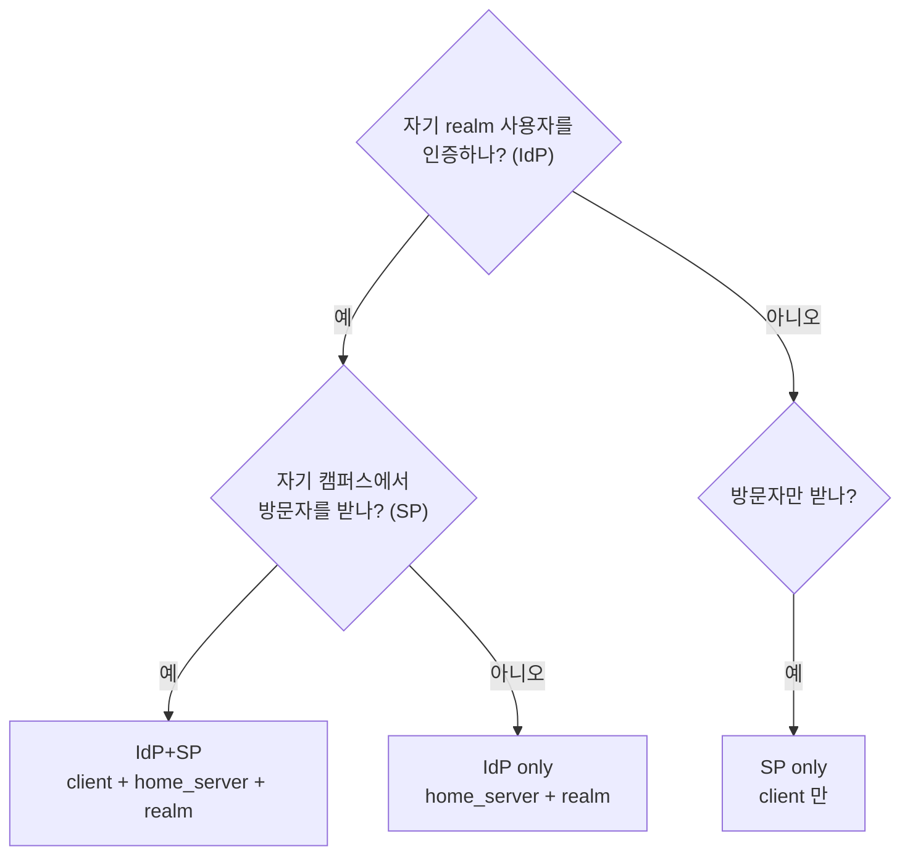

# 기관 등록·해지

기관을 NRO 에 붙이는 절차. 역할에 따라 고칠 파일이 다르다.

## 파일 배치

기관 하나 = `conf.d/<realm>.conf` 파일 하나. 그 안에 **client · home_server · pool · realm 을 모두** 넣는다. 추가·해지가 파일 하나로 끝난다.

```
freeradius/
├─ proxy.conf        $INCLUDE 순서 + 국제 경로
├─ clients.conf      루프백·ETLR 같은 공통 항목만
├─ blackhole.conf    라우팅 불가 realm
├─ conf.d/           기관 설정 — 구조만. IP·공유키는 ${...} 참조
├─ secrets.d/        기관 값 — IP·공유키. 비공개
└─ conf.disabled/    읽히지 않음(비활성)
```

`conf.d/<realm>.conf` 와 `secrets.d/<realm>.cfg` 가 **짝**이다. 구조는 공개, 값은 비공개다. → `AGENTS.md`

### 파일명은 realm 하나

접미사를 붙이지 않는다. 역할(SP / IdP / 둘 다)은 파일 안의 블록이 말한다 — `client` 만 있으면 SP, `home_server` 와 `realm` 만 있으면 IdP 다.

한 기관이 realm 을 여럿 쓰거나 여러 realm 이 같은 홈서버를 공유하면 **한 파일에 모은다.** 그 사실은 `secrets.d/<realm>.cfg` 에 적는다.

**정규식 realm 은 `conf.d/` 에 두지 않는다.** 정규식끼리는 나열 순서가 결정적인데 디렉터리 include 는 파일시스템 순서라 순서를 보장할 수 없다. → `proxy.conf` 에 직접.

### ⚠️ 디렉터리 include 규칙 — `.disabled` 는 통하지 않는다

FreeRADIUS 소스(`src/main/conffile.c`)가 건너뛰는 파일은 다음뿐이다.

| 건너뜀 | 예 |
|---|---|
| `.` 으로 시작하는 파일 | `.example.ac.kr.conf` |
| 이름에 `[A-Za-z0-9_.-]` 외 문자가 있는 파일 | `example.ac.kr.conf~` |
| `.dpkg-dist`, `.dpkg-old`, `.rpmnew`, `.rpmsave` | 패키지 관리자 산출물 |
| **하위 디렉터리** | `conf.d/disabled/` |

즉 **`example.ac.kr.conf.disabled` 는 그대로 읽힌다.** 확장자를 바꾸는 방식은 비활성화가 아니다. 문자가 전부 허용범위(영숫자·`.`·`-`·`_`)라 정상 파일로 취급된다.

**비활성화하려면** 둘 중 하나를 쓴다.

```bash
mkdir -p conf.d/disabled
mv conf.d/example.ac.kr.conf conf.d/disabled/    # 하위 디렉터리는 건너뛴다
# 또는
mv conf.d/example.ac.kr.conf conf.d/.example.ac.kr.conf   # 점으로 시작
```

바꾼 뒤에는 반드시 `radiusd -C` 로 확인한다. 비활성화한 파일이 정의하던 home_server 를 다른 파일이 참조하고 있으면 **기동이 실패**한다.

> `conf.d/` 가 world-writable(`o+w`) 이면 FreeRADIUS 가 **기동을 거부**한다.
> 권한은 `755` 이하로 유지한다.

## 역할 구분

| 역할 | 뜻 |
|---|---|
| **SP only** | 방문자만 받는다. 자기 realm 없음 |
| **IdP only** | 자기 사용자만 인증한다. 방문자 안 받음 |
| **IdP + SP** | 둘 다. 가장 흔하다 |



## 고칠 파일

| | `conf.d/<realm>.conf` | `secrets.d/<realm>.cfg` | `nro-direct-realms.conf` |
|---|---|---|---|
| SP only | client | IP · 공유키 | — |
| IdP only | home_server · pool · realm | IP · 공유키 | ✅ |
| IdP + SP | 위 둘 다 | IP · 공유키 | ✅ |

`client` = **우리에게 보내오는** 쪽 / `home_server` = **우리가 보내는** 쪽. 둘은 보통 같은 장비다.

`radsecproxy/nro-direct-realms.conf` 는 국제에서 RadSec 으로 돌아온 요청을 내려보내는 표다.

> **NRO 에 직결하는 기관을 추가하면 이 파일도 반드시 고친다.** `conf.d/` 에만 넣고 여기 빠뜨리면, 국내에서는 되는데 **해외에서 그 realm 으로 들어온 요청이 ETLR 로 되돌아간다.** 국내에서만 확인하면 드러나지 않는 종류의 실수다.
>
> RO 가 중계하는 기관은 여기 넣지 않는다. 그쪽 realm 은 이 경로로 오지 않는다.

## 사전 확인 사항

기관에서 받아야 할 것:

- **realm** (IdP 인 경우) — 예: `example.ac.kr`
- **RADIUS 서버 IP** — SP 로 보내오는 IP, IdP 로 받는 IP (보통 같음)
- **Status-Server 지원 여부** → `docs-priv/coordination.md` 6번
- 담당자 연락처

기관에 알려줄 것:

- NRO 주소(등록 안내 시 개별 전달), 포트 `1812`(인증) / `1813`(어카운팅)
- **공유키** (아래 규칙)

> **공유키는 기관당 하나를 양방향에 같이 쓰는 것이 관례다.** 기관이 방향별로 다른 키를 요구하면 `<REALM>_SECRET_1` / `_2` 로 나눈다. → `AGENTS.md`

---

## SP only 추가

방문자만 받는 기관. realm 이 없으므로 라우팅표는 건드리지 않는다.

**1) `secrets.d/example.ac.kr.cfg`** — 값

```
EXAMPLE_AC_KR_IPADDR = 203.0.113.10
EXAMPLE_AC_KR_SECRET = '<공유키>'
```

**2) `conf.d/example.ac.kr.conf`** — 구조

```
client 2026_example_ac_kr_10 {
	ipaddr = ${EXAMPLE_AC_KR_IPADDR}
	secret = ${EXAMPLE_AC_KR_SECRET}
	shortname = 2026_example_ac_kr_10
	operator_name = '1example.ac.kr'
}
```

`operator_name` 은 방문기관 식별자라 **client 마다 자기 realm** 을 넣는다. → `operator-name.md`

이름 규칙은 `(연도)_(realm 의 . → _)_(IP 마지막 옥텟)`. → `radius-routing.md`

---

## IdP + SP 추가 (가장 흔함)

한 장비가 두 역할을 겸하는 경우다. 같은 IP·같은 공유키를 쓰고 **블록 이름도 같게** 맞춘다. 그래야 로그(`from client 2026_example_ac_kr_10`)와 라우팅표가 바로 대조된다.

**1) `secrets.d/example.ac.kr.cfg`**

```
EXAMPLE_AC_KR_IPADDR = 203.0.113.10
EXAMPLE_AC_KR_SECRET = '<공유키>'
```

**2) `conf.d/example.ac.kr.conf`**

```
client 2026_example_ac_kr_10 {
	ipaddr = ${EXAMPLE_AC_KR_IPADDR}
	secret = ${EXAMPLE_AC_KR_SECRET}
	shortname = 2026_example_ac_kr_10
	operator_name = '1example.ac.kr'
}

home_server 2026_example_ac_kr_10 {
	type = auth+acct
	ipaddr = ${EXAMPLE_AC_KR_IPADDR}
	port = 1812
	src_ipaddr = ${NRO_IPADDR}
	secret = ${EXAMPLE_AC_KR_SECRET}
	response_window = 20
	zombie_period = 40
	revive_interval = 120
}

home_server_pool pool_example_ac_kr {
	type = fail-over
	home_server = 2026_example_ac_kr_10
}

realm example.ac.kr {
	auth_pool = pool_example_ac_kr
	acct_pool = pool_example_ac_kr
	nostrip
}

realm "~^(.+\.)example\.ac\.kr$" {
	virtual_server = auth-reject
	nostrip
}
```

- **서브도메인 거절 블록을 같은 파일에 함께 넣는다.** 기관이 실제로 서브도메인 realm 을 운영한다고 확인되면(로그에 성공 기록) 그때만 pool 로 바꾼다. → `radius-routing.md`
- 서버가 여러 대면 `home_server` 를 여러 개 정의하고 pool 에 나열한다. **`type` 은 반드시 `fail-over`.** load-balance 는 EAP 를 깨뜨린다.
- `status_check` 는 넣지 않는다. 응답하는 국내 홈서버가 없다. → `eduroam-settings.md`

**방문자를 받지 않는 기관(IdP only)이면 `client` 블록만 빼면 된다.** 나머지는 같다.

**3) `radsecproxy/nro-direct-realms.conf`** — realm 목록에 추가

```
realm /@(…|example\.ac\.kr)$/i {
    server freeradius-udp
}
```

정규식이므로 `.` 을 `\.` 로 이스케이프한다. 백슬래시는 **하나**다.

---

## 반영과 확인

```bash
# 1. 문법 검사
docker compose run --rm freeradius -C -lstdout

# 2. 반영
docker compose restart freeradius
docker compose restart radsecproxy   # nro-direct-realms.conf 를 고친 경우

# 3. 경로 확인
alias radclient='docker exec -i kr-nro-freeradius /opt/bin/radclient'
echo "User-Name=user@example.ac.kr,User-Password=x" | radclient -x 127.0.0.1:1812 auth '<루프백 공유키>'
```

**Access-Reject 가 오면 정상**(경로가 살아 있다는 뜻). 무응답이면 realm 미매칭이거나 홈서버 불통이거나 공유키 불일치다. → `radius-routing.md`

---

## 해지

1. **로그로 사용량부터 확인한다.** 활동이 있으면 공지·유예가 먼저다.
2. `conf.d/<realm>.conf` 를 `conf.disabled/` 로, `secrets.d/<realm>.cfg` 를 `secrets.disabled/` 로 옮긴다. 짝을 유지해야 되살릴 수 있다. → `AGENTS.md`
3. **⚠️ `.ac.kr` realm 이면 옮기는 것만으로는 부족하다.** catch-all `~(.*\.)*ac\.kr$` 을 타고 RO 로 전달된다. 더 이상 어디로도 보내면 안 되는 realm 은 `blackhole.conf` 에 정확일치로 등록한다.
4. `radsecproxy/nro-direct-realms.conf` 에서 realm 을 뺀다.
5. 문법 검사 → 재시작.

옮기기 전에 **그 파일의 홈서버를 다른 파일이 참조하는지** 확인한다. 지운 뒤에는 고아(어느 pool 도 참조하지 않는 home_server)가 없는지 본다.


## 남은 확인 사항

- eduroam 연합 데이터베이스(eduroam.org) 등록 절차가 별도로 필요한지 확인. 국가 NRO 로서 참여기관을 연합에 등록해야 한다면 이 문서에 단계를 추가한다.
