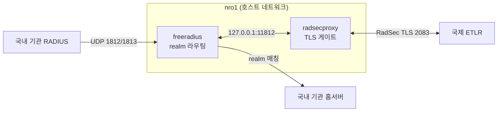

# 구성 개요

## 용어

| 약어 | 풀이 | 뜻 |
|---|---|---|
| **NRO** | National Roaming Operator | 한 국가의 eduroam 중계 주체. 이 서버 |
| **RO** | Roaming Operator | 국가 안에서 여러 기관을 묶어 중계하는 주체 |
| **ETLR** | eduroam Top Level RADIUS | 국가 간 중계를 맡는 상위 서버 |
| **IdP** | Identity Provider | 자기 realm 사용자를 인증하는 기관 |
| **SP** | Service Provider | 방문자에게 네트워크를 내주는 기관 |
| **EAP** | Extensible Authentication Protocol | 단말과 IdP 사이의 인증 프로토콜. 중계자는 열어 보지 않는다 |
| **RadSec** | RADIUS over TLS | 서버 간 RADIUS 를 TLS 로 감싼 것. 2083 |

## 이 서버가 하는 일

eduroam KR NRO

- 국내 기관에서 온 인증 요청을 realm 보고 **해당 기관 홈서버로 중계**
- 모르는 realm(해외)은 **국제 ETLR 로 올려보냄**
- 해외에서 들어온 국내 realm 요청을 **국내 기관으로 내려보냄**

**로컬 사용자도 없고 EAP 를 종단하지도 않는다.** 순수 중계다. 그래서 FreeRADIUS 쪽에는 인증서가 필요 없다(→ `certificates.md`).

## 컨테이너 두 개

| 컨테이너 | 하는 일 |
|---|---|
| `freeradius` | realm 라우팅, 정책. 1812/1813(UDP) 소유 |
| `radsecproxy` | RadSec(TLS/2083) 구간만 담당하는 게이트웨이 |



정책은 FreeRADIUS 한 곳에만 있다. 전송 방식(UDP↔RadSec)이 바뀌어도 realm 라우팅 로직은 건드리지 않는다. → `radsec-migration.md`

두 컨테이너 모두 **호스트 네트워크 모드**로 뜬다. RADIUS 는 출발지 IP 로 클라이언트를 식별하므로 NAT 를 거치지 않는 편이 로그와 정책이 명확하다. 내부 통신은 `127.0.0.1` 이고, 내부 전용 포트(11812)는 루프백에만 바인딩한다.

## 파일 구성

```
kr-nro/
├─ docker-compose.yml
├─ freeradius/
│  ├─ proxy.conf            목차. $INCLUDE 순서 + 국제 경로
│  ├─ blackhole.conf        라우팅 불가 realm 즉시 거절
│  ├─ conf.d/               기관별 설정
│  ├─ kren_ro.conf          KREN RO (.ac.kr catch-all)
│  ├─ clients.conf          루프백·ETLR 등 공통 client
│  ├─ sites-enabled/default 요청 처리 흐름
│  ├─ mods-enabled/eap      빈 파일(모듈 비활성화)
│  └─ mods-config/attr_filter/{pre,post}-proxy
├─ radsecproxy/
│  ├─ radsecproxy.conf
│  ├─ nro-direct-realms.conf  이 NRO 가 담당하는 realm 목록
│  └─ certs/                RadSec 인증서
├─ pki/                     RadSec CA·인증서 생성 설정
└─ docs/
```

설정 파일은 직접 고쳐서 관리한다. **realm 을 바꾸면 `proxy.conf` 와 `nro-direct-realms.conf` 를 함께** 고쳐야 한다.

## 현재 규모

- realm **28개**, 홈서버 **24개**, 등록 기관(클라이언트) **22개**
- 인증량: 일 20~27만 건 수준
