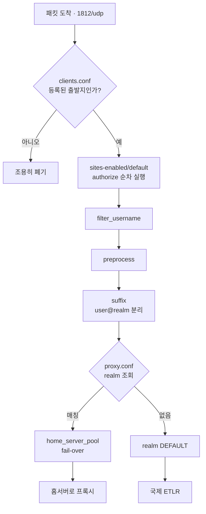
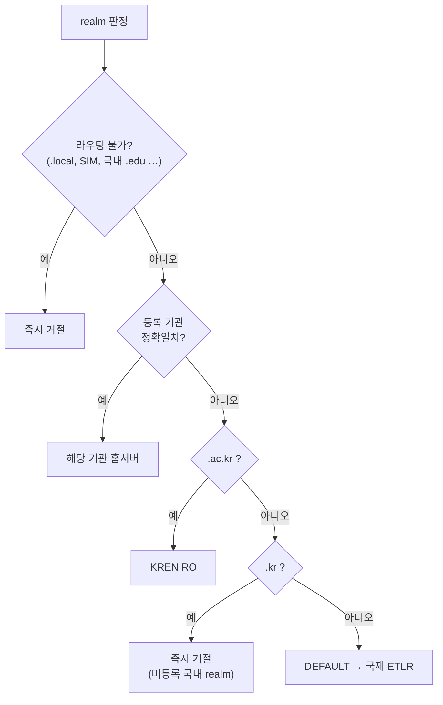
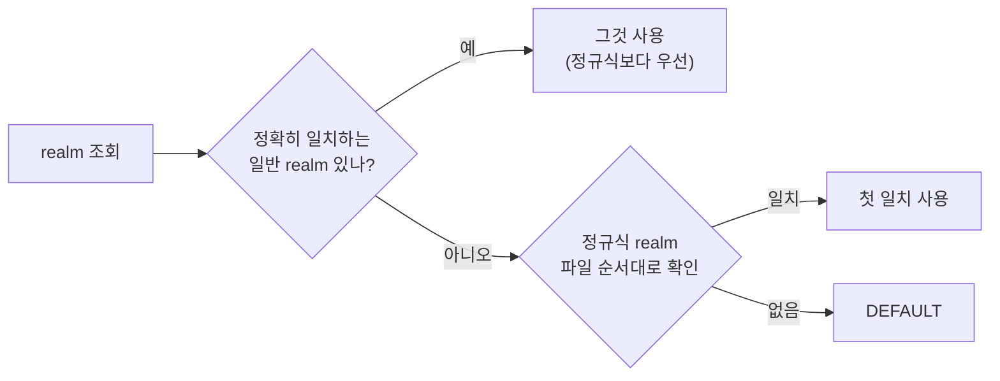

# 요청 처리와 realm 라우팅

## 요청이 흐르는 순서



**순차 처리되는 파일은 `sites-enabled/default` 하나뿐**이다. `clients.conf` 와 `proxy.conf` 는 그 과정에서 참조되는 조회 테이블이지 위에서부터 실행되는 정책이 아니다.

## 전체 라우팅 원칙



**`.kr` 은 국내에서 끝낸다.** `.kr` 은 한국 네임스페이스이므로, 어느 기관에도 매칭되지 않고 `.ac.kr` 도 아니라면 ETLR 로 내보내도 처리할 곳이 없다. 국제 회선만 소모하고 100% 실패한다.

실측(2026-09)이 이를 뒷받침한다. 성공하는 `.kr` 은 **전부 등록된 기관**이고, 미등록 `.kr` 은 전부 성공 0 이다. 수치는 `docs-priv/measurements.md`

`kren_ro.conf` 맨 아래에 둔다. **`.ac.kr` catch-all 보다 아래**여야 한다. 위에 두면 `.ac.kr` 이 KREN 으로 가지 못하고 전부 거절된다.

```
realm "~^(.*\.)*ac\.kr$" { auth_pool = pool_kren_ro }   ← 먼저
realm "~^(.*\.)*kr$"      { virtual_server = auth-reject } ← 나중
```

## 파일 읽는 순서 = 정책

`proxy.conf` 는 목차다. `$INCLUDE` 순서가 곧 정규식 평가 순서이므로 **순서 자체가 라우팅 정책**이다.

```
blackhole.conf   라우팅 불가 realm 차단        ← 가장 먼저
conf.d/          기관별 (정확일치 + 서브도메인)
kren_ro.conf     KREN RO, 마지막에 .ac.kr catch-all
(proxy.conf)     DEFAULT → 국제 ETLR           ← 최후
```

`conf.d/` 안은 파일시스템 순서라 보장되지 않지만, 각 기관 정규식은 `^` 로 앵커되어 **서로 겹치지 않으므로** 순서가 무관하다. 겹칠 수 있는 것(`.ac.kr` catch-all)만 별도 파일로 빼서 위치를 고정했다.

## realm 매칭 규칙

목록을 위에서부터 순차로 보는 방식이 아니다. 공식 `proxy.conf` 주석 기준:



정리하면:
- 개별 realm 은 **파일 어디에 있든 정규식 realm 보다 우선**한다. 일반 realm 끼리는 순서가 무관하다.
- **정규식 realm 끼리는 순서가 결정적이다.** 넓은 정규식을 위에 두면 좁은 정규식이 영영 매칭되지 않는다. 정규식을 추가할 때는 **좁은 것을 위로** 올린다. 현재 정규식은 `~\.ac\.kr$` 하나뿐이라 결과적으로 문제가 없는 상태일 뿐이다.
- 정규식은 적을수록 성능에 유리하므로 늘리지 않는 편이 좋다.
- 이 동작은 FreeRADIUS **2.x 와 3.x 가 동일**하다(양쪽 `raddb/proxy.conf` 주석 동일).
- `DEFAULT` 는 항상 마지막(→ 국제 ETLR).

### 정규식 표기 규칙

```
realm "~^(.*\.)*gist\.ac\.kr$" { ... }
```

| 요소 | 이유 |
|---|---|
| **큰따옴표** | 파서가 특수문자를 그대로 넘긴다 (upstream 권장) |
| **`^` 앵커** | **없으면 `gist` 패턴이 `dgist.ac.kr` 을 잡는다.** 정규식은 자동 앵커되지 않아 문자열 중간부터 매칭된다 |
| **`(.*\.)*`** | 도메인 자신과 모든 하위 도메인을 함께 잡는다 |
| **끝의 `$`** | 없으면 `gist.ac.krFOO` 같은 중간 일치가 생긴다 |
| **`\.`** | 점을 이스케이프. 백슬래시는 **하나**다. `\\.` 로 쓰면 "백슬래시+임의문자"가 되어 매칭이 깨진다 |

upstream 예시(`"~(.*\.)*example\.net$"`)에는 `^` 가 없는데, 그대로 쓰면 `myexample.net` 도 매칭된다. **앵커를 반드시 넣는다.**

### 서브도메인은 쓰지 않는다

**기관 realm 은 정확일치 하나만 둔다.** 서브도메인 정규식은 두지 않는다.

각 기관은 무선 컨트롤러 하나에 realm 하나만 선언한다. 서브도메인 realm 을 운영하는 기관이 없으므로, 우리가 잡아서 보내도 **홈서버가 거절**한다.

실측(2026-09): 서브도메인 realm 의 성공은 0 이고 실패만 쌓인다. 메일 주소가 아니라 별도 등록 절차로 eduroam 계정을 발급하는 기관은 특히 분명하다 — realm 이 기관 도메인 하나뿐이다. 수치는 `docs-priv/measurements.md`

그래서 서브도메인 차단 규칙은 **각 기관 파일(`conf.d/`) 안에** 둔다. 기관 하나 = 파일 하나 원칙이 유지되고, 기관을 추가·해지할 때 그 파일만 만들거나 지우면 된다. `blackhole.conf` 에 모아 두면 기관을 지울 때마다 두 파일을 동기화해야 해서 빠뜨리기 쉽다.

```
realm "~^(.+\.)example\.ac\.kr$" { virtual_server = auth-reject  nostrip }
```

`(.+\.)` 로 시작하므로 **realm 자신은 잡지 않고 서브도메인만** 잡는다. ETLR 로 내보내 실패하는 대신 NRO 에서 즉시 끊는다.

서브도메인 정규식끼리는 각자 다른 도메인을 앵커로 잡으므로 **서로 겹치지 않는다.** `conf.d/` 가 파일시스템 순서라도 안전하다(검증 완료).

> 어떤 기관이 실제로 서브도메인 realm 을 운영하게 되면, 그 파일의 거절 블록을
> 기관 pool 로 바꾼다. **로그에 성공 기록이 있을 때만** 한다.

## 홈서버와 pool

- 한 realm 에 홈서버가 여럿이면 `home_server_pool` 로 묶인다.
- **`type = fail-over` 고정.** load-balance 를 쓰면 EAP 대화가 서버 둘로 갈라져 홈서버에서 `No EAP session matching the State variable` 이 발생한다. (2026-09 한 기관의 장애 문의에서 원인으로 지목된 사안)
- **같은 서버(IP·포트·키)는 home_server 를 하나만 정의**한다. 중복 정의하면 Status-Server 생존확인이 중복으로 돌고 zombie 상태가 따로 관리된다.

## realm 을 지우면 catch-all 로 떨어진다 ⚠️

`~(.*\.)*ac\.kr$` catch-all 이 KREN RO 를 가리키므로, **`.ac.kr` realm 을 그냥 지우면 "차단"이 아니라 "KREN 으로 전달"이 된다.**

특히 **KREN 을 거치지 않고 NRO 에 직접 붙는 기관**이 위험하다. 이들의 서브도메인이 catch-all 을 타면 잘못된 곳으로 간다. 실제로 로그에 있었다. 수치는 `docs-priv/measurements.md`

그래서 직접 연동 기관은 **서브도메인까지 포함하는 정규식**을 catch-all 보다 위에 둔다.

```
realm "~(.*\.)*kaist\.ac\.kr$"   { auth_pool = pool_kaist_ac_kr ... }
realm "~(.*\.)*postech\.ac\.kr$" { ... }
realm "~(.*\.)*dgist\.ac\.kr$"   { ... }
realm "~(.*\.)*gist\.ac\.kr$"    { ... }

realm "~(.*\.)*ac\.kr$"           { auth_pool = pool______ac___kr }  ← 마지막
```

**더 이상 쓰지 않는 realm 은 지우지 말고 블랙홀에 넣는다.** 테스트용 realm 을 종료 후 삭제했더니 catch-all 로 KREN 에 가고 있던 사례가 있다. 지금은 `blackhole.conf` 에 정확일치로 등록해 차단한다.

## Operator-Name

방문기관(SP)을 식별하는 속성이다. NRO 가 일괄로 붙이지 않고 **client 별 고유값만** 붙인다. 지금은 설정한다 — 예전에는 설정하지 않았고 그 시절 설명이 여기 남아 있었다.

자세한 내용은 [operator-name.md](operator-name.md)

## realm 정리 정책

`proxy.conf` 와 `nro-direct-realms.conf` 에서 관리한다.

| realm | 상태 |
|---|---|
| 테스트 realm 둘 | **2026-10-15 비활성.** 응답할 홈서버를 띄운 적이 없다 |
| 시범 임시계정 realm | **2026-09-23 종료.** `.kr` catch-all 이 받아 끊는다 |
| 활동 0건인 realm 셋 | 삭제함 |

경위와 목록은 `docs-priv/measurements.md` · `docs-priv/disabled-configs.md`

> 분원 realm 이 본원과 통합되어 쓰이지 않게 된 사례가 있다. 경위는 `docs-priv/measurements.md`

## 경로 확인 (라우팅 점검)

테스트 요청을 하나 흘려 **realm 이 제대로 매칭되어 홈서버까지 닿는지** 본다. 인증 성공 여부를 보는 게 아니라 **경로가 살아 있는지**를 보는 점검이다.

```bash
alias radclient='docker exec -i kr-nro-freeradius /opt/bin/radclient'

echo "User-Name=user@example.ac.kr,User-Password=x" | radclient -x 127.0.0.1:1812 auth radsec
```

- `127.0.0.1:1812` — 호스트 네트워크 모드라 컨테이너 안의 루프백이 곧 호스트다. 자기 자신(freeradius)에게 Access-Request 를 보낸다.
- `radsec` — `clients.conf` 의 `localhost` 항목 공유키.
- `-x` — 주고받은 속성을 자세히 출력.
- 유효한 자격증명이 아니므로 **결과는 Access-Reject 가 정상**이다.

응답으로 판정한다.

| 결과 | 의미 |
|---|---|
| **Access-Reject** | 경로 정상. realm 매칭 → 홈서버 도달 → 응답까지 성공 |
| **무응답(timeout)** | 경로 이상. realm 미매칭, 홈서버 불통, 공유키 불일치 등 |

realm 을 바꿔 가며 확인하면 구간별로 좁힐 수 있다. 등록된 realm 은 그 기관 홈서버로, 모르는 realm 은 국제 ETLR 로 간다.

서버 쪽에서 어느 realm 에 매칭됐고 어느 홈서버로 갔는지 보려면 `docker compose logs -f freeradius` 를 함께 띄워 둔다(`-X` 디버그 모드 기준).

> `alias` 에 `-it` 대신 **`-i`** 를 쓴다. 파이프로 입력을 넣는데 `-t`(TTY)를
> 붙이면 `the input device is not a TTY` 로 실패한다.

### EAP 까지 확인하려면 radclient 로는 부족하다

위 점검은 **realm 이 홈서버까지 닿는지**만 본다. 단말이 실제로 겪는 EAP 터널까지 확인하려면 `eapol_test` 를 쓴다.

```
eapol_test -c peap.conf -a <NRO> -p 1812 -s <공유키> -r0
```

```
network={
	ssid="eduroam"
	key_mgmt=WPA-EAP
	eap=PEAP
	identity="<계정>@<realm>"
	password="deliberately-wrong"
	phase2="auth=MSCHAPV2"
}
```

경로가 살아 있으면 상대 서버 인증서까지 받고 **비밀번호 단계에서만** 실패한다.

```
CTRL-EVENT-EAP-PEER-CERT depth=0 subject='/CN=example.ac.kr'
EAP: Status notification: remote certificate verification (param=success)
EAP: Status notification: completion (param=failure)
```

> **`radclient` 로는 EAP 를 시험할 수 없다.** `EAP-Type-Identity` 를 줘도 `EAP-Message` 를 만들어 주지 않아 자격증명 없는 맨 요청이 나간다. 기관에 따라 거절하거나 조용히 버려서 **거짓 음성**이 난다.
