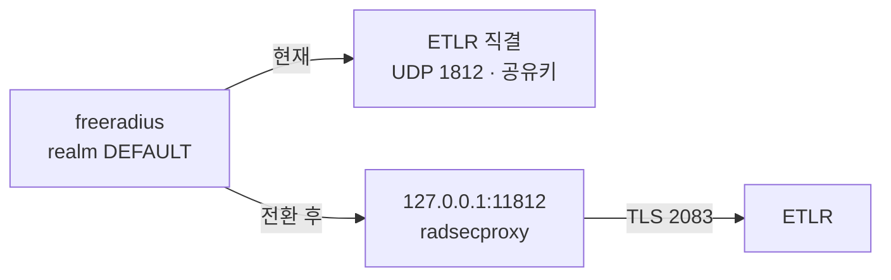

# RadSec 전환

## 현재 상태

국제 ETLR 과는 **UDP 직결**이다. 공유키로 맺는다. RadSec 전환을 아직 연합에 공지하지 않았다. radsecproxy 는 띄워 두되 국제 구간에서는 유휴 상태다.

## 왜 지금은 꺼 두었나

한때 켜 두었으나 **ETLR 로의 아웃바운드 TLS 가 계속 실패해 로그만 쌓였다.**

```
verify error num=19 self-signed certificate in chain
```

원인은 CA 번들에 **자체 CA 한 장만** 들어 있어 ETLR 서버 인증서 체인의 상위 루트를 검증할 수 없는 것이었다. 인바운드(2083)는 실사용이 0건이었고 국제 경로는 `proxy.conf` 의 UDP 직결을 쓰므로, 중지해도 영향이 없었다.

되살리려면 **필요한 루트를 `pki/certs/eduroam-ca.pem` 에 추가**한 뒤 `docker-compose.yml` 의 `radsecproxy` 블록 주석을 풀고 올린다. 그 블록은 주석만 풀면 그대로 동작하도록 두었다.

## 전환 방법

`freeradius/proxy.conf` 맨 아래 DEFAULT 구역에서 주석 두 곳만 바꾼다.



**전환**

1. `home_server tlr { ... }` 블록의 주석을 푼다.
2. `pool_default` 에서 기존 `home_server` 줄을 주석 처리하고 `home_server = tlr` 의 주석을 푼다.
3. `docker compose restart freeradius`

**롤백**은 반대로. 공유키는 그대로 남아 있어 즉시 복구된다.

## 전환이 간단한 이유

**나가는 쪽은 홈서버 하나만 바뀐다.** `realm DEFAULT` 와 pool 구조는 그대로라 나머지 realm 27개는 영향이 없다.

**들어오는 쪽은 전환이 필요 없다.** `clients.conf` 에 ETLR 과 루프백(radsecproxy 가 내려보내는 경로)이 **둘 다** client 로 등록돼 있어, 상대가 UDP 로 오든 TLS 로 오든 모두 수용한다. 상대가 언제 전환하든 우리 쪽은 준비된 상태다.

## 권장 순서

1. **지금**: UDP 그대로 운영. 변수를 줄이기 위해 전송 방식은 건드리지 않는다.
2. RadSec 인증서 발급(`../pki/`), 연합에 RadSec 피어 등록 요청, 상대 ETLR 엔드포인트·요구 CA 확인.
3. **내부 구간 먼저**: IdP → NRO 구간만 RadSec 으로 바꿔 검증한다. 양쪽 다 우리 것이라 국제 구간에 영향이 없다.
4. 검증되면 국제 구간 전환.

## radsecproxy 쪽 라우팅

`radsecproxy.conf` 는 이 NRO 가 담당하는 realm 목록을 `nro-direct-realms.conf` 에서 include 한다. 국제에서 RadSec 으로 들어온 요청 중 국내 realm 은 FreeRADIUS 로 내려보내고, 나머지는 ETLR 로 올려보낸다. realm 을 추가·삭제하면 이 파일도 함께 고친다.

## 확인 필요

- 국제 ETLR 의 현행 RadSec 엔드포인트와 요구 CA (연합 운영자 확인)
- 상대가 요구하는 `TLS_PolicyOID` 설정 여부
- RadSec 인증서 SAN 의 URI 포맷 (역할 식별자) — GÉANT/eduPKI 문서로 확정
